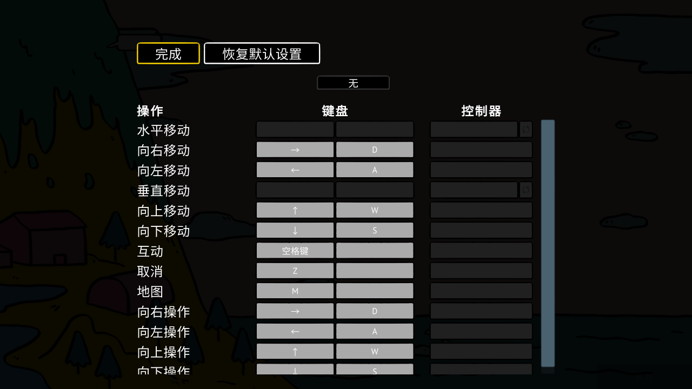
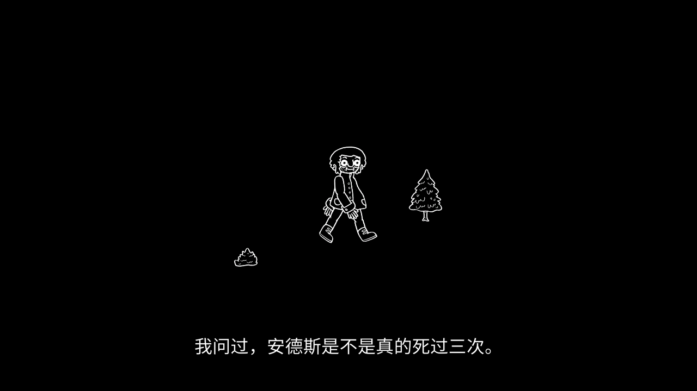
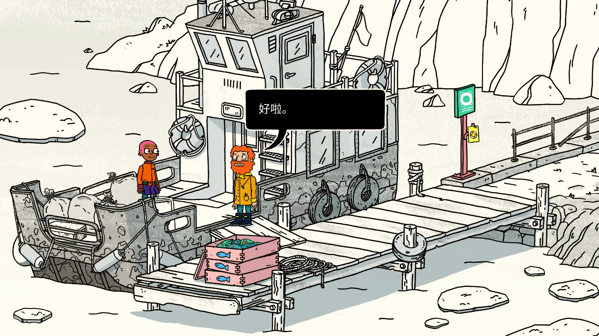

# Welcome to Elk 简体中文汉化

非官方简体中文汉化补丁 · **0.1.0-rc.1 候选测试版**

基于 Steam PC 版原有英语文本进行本地化，共 **70 批、6,429 条**，由 GPT-6 Luna（max）初译、GPT-6.1 Sol（high）逐批校对。中文字体使用 **Source Han Sans SC 2.005（思源黑体简体中文版）**。

## 下载

**[下载完整汉化补丁 ZIP（约 13.21 MiB）](https://github.com/newbility/Welcome_to_Elk_CN/raw/refs/heads/main/downloads/WelcomeToElk_zh-CN_0.1.0-rc.1.zip)** · [SHA-256 校验文件](downloads/WelcomeToElk_zh-CN_0.1.0-rc.1.zip.sha256)

解压整个 ZIP 后使用，不要只取出单个脚本。此仓库通过 `downloads` 目录直接提供下载，当前没有单独创建 GitHub Release。

```text
SHA-256: 600de98f3dfe44cf160fb4bbca0e2b385d0b8e5b4ed528ce459836791238acd9
```

## 安装、校验与恢复

1. 退出游戏，解压下载的完整汉化包。
2. 双击 `Install.cmd`，输入 Welcome to Elk 的游戏安装目录。
3. 进入游戏，在语言设置中选择 **简体中文**（替换原 English 语言槽）。
4. `Verify.cmd` 用于检查安装结果；`Restore.cmd` 使用安装时保留的备份恢复原文件。

安装器会先检查游戏版本/文件 SHA-256，完整解码并备份后再替换文件。未知版本或其他修改会触发拒绝覆盖。请保留游戏目录中的 `.WelcomeToElkCN` 备份和安装记录；新下载的 ZIP 不能替代用户自己的原文件备份。安装器不修改存档。

适配基线：Steam PC 版 **V1.22 / build 8294237**。以实际文件哈希匹配为准。默认 Steam 路径示例：`…/Steam/steamapps/common/Welcome to Elk`。

补丁自带解码器和运行文件，不依赖开发者的共享工具库、Python 或开发脚本。系统要求为 Windows PowerShell 5.1 和 Microsoft Visual C++ x64 运行库；若提示缺少 `VCRUNTIME140.dll`，请从[微软官方页面](https://learn.microsoft.com/cpp/windows/latest-supported-vc-redist)安装受支持的 x64 运行库。

## 演示图片

以下均为项目测试副本的实际游戏截图，未生成或重绘游戏画面。

### 主菜单


### 控制设置


### 开场字幕


### 剧情对白


## 验证范围

- 70/70 批译文及控制码、变量、换行、原文哈希检查通过。
- 6,227 条表格文本、102 条字幕、143 个界面显示目标逐项从构建资源读回核对。
- 字幕时间轴与序号未改变；17,623 个不在修改范围内的 Unity 对象保持原字节。
- 译文使用的全部 1,749 个汉字通过字形覆盖与运行时动态字形生成检查。
- 已实机检查主菜单、选项、语言、控制设置、开场字幕、第一幕标题、开场对白与教学提示。
- 独立安装包通过 13 项安装、校验、重复安装、恢复、含空格路径、交互输入、拒绝未知改动及拒绝损坏补丁等检查。

**尚未进行全流程通关测试**，不能据此保证所有后续剧情、小游戏、长文排版、控制器型号或分辨率均已验证。游戏 LOGO、真实署名及部分作品/品牌名保留原文。详细信息见 [VALIDATION.json](VALIDATION.json)。问题反馈请附游戏版本、出现场景和截图：[提交 Issue](https://github.com/newbility/Welcome_to_Elk_CN/issues)。

## 版权与免责声明

1.本补丁仅供学习与交流使用，不得用于任何商业用途，请在已购买正版游戏的前提下使用。
2.游戏文本及资源的版权归开发者/发行商所有；中文译文采用 CC BY-NC-SA 4.0 协议；字体使用思源黑体简体中文版（Source Han Sans SC），遵循 SIL Open Font License 1.1。如有侵权，请联系移除。
3.本汉化包为非官方汉化程序，对于使用汉化包而造成的任何损失，本人不负任何责任。
4.您肯定已经详细阅读并已理解本协议，并同意严格遵守免责声明的各条款和条件。如不同意，请勿使用。

中文译文的协议范围见 [LICENSE-TRANSLATION.md](LICENSE-TRANSLATION.md)，字体和第三方软件的许可见 [licenses](licenses)。
